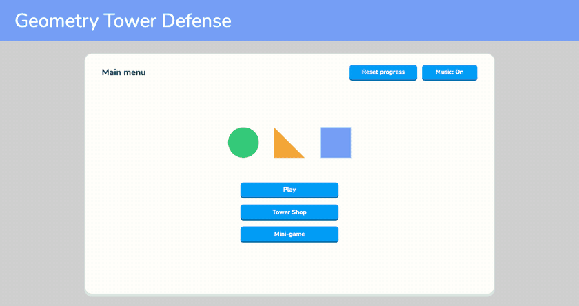
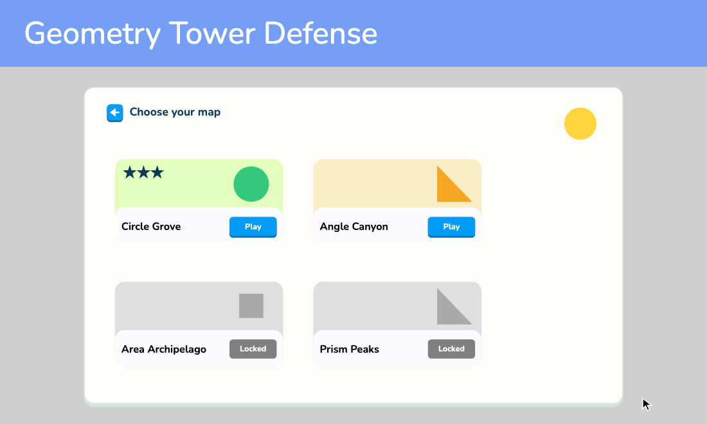
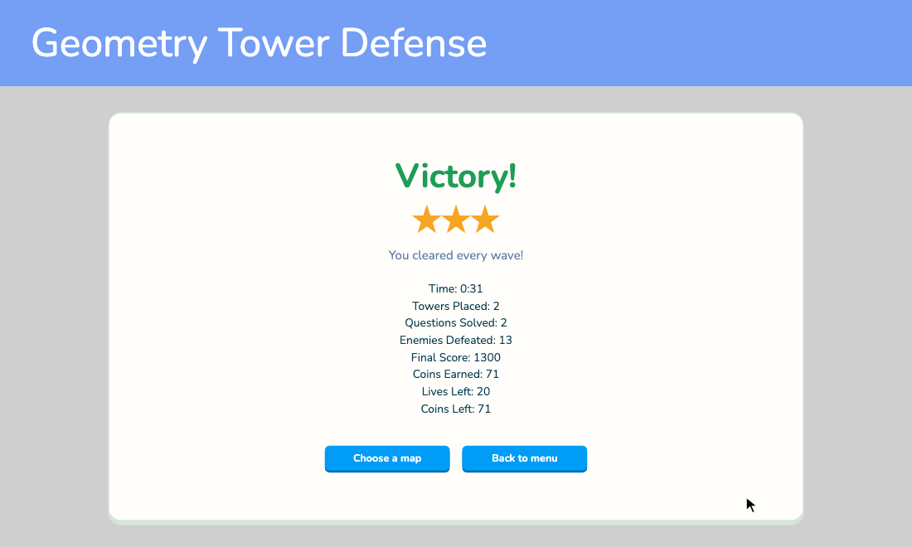
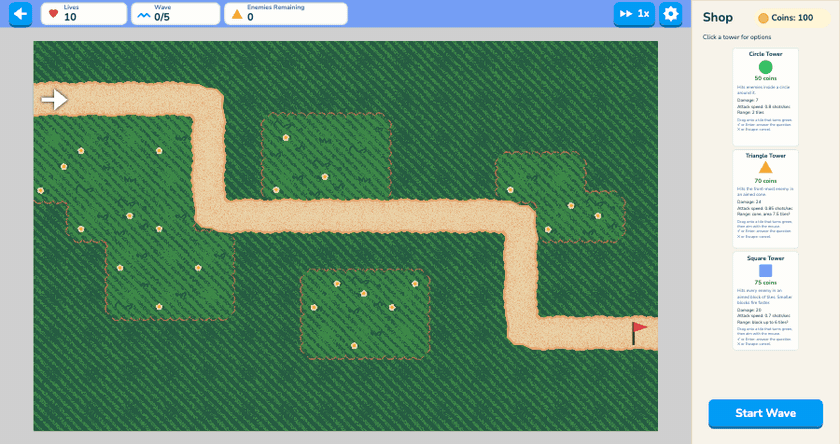
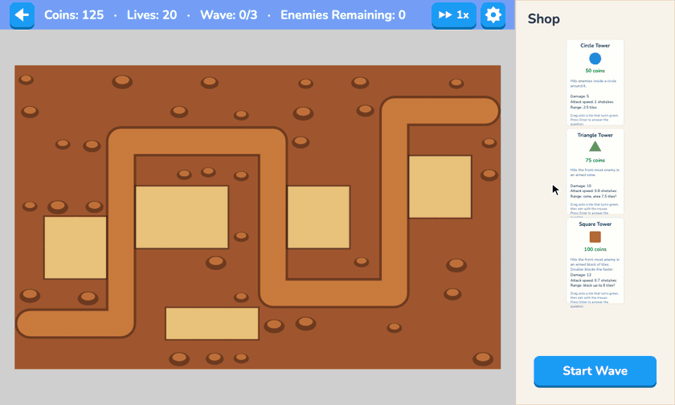
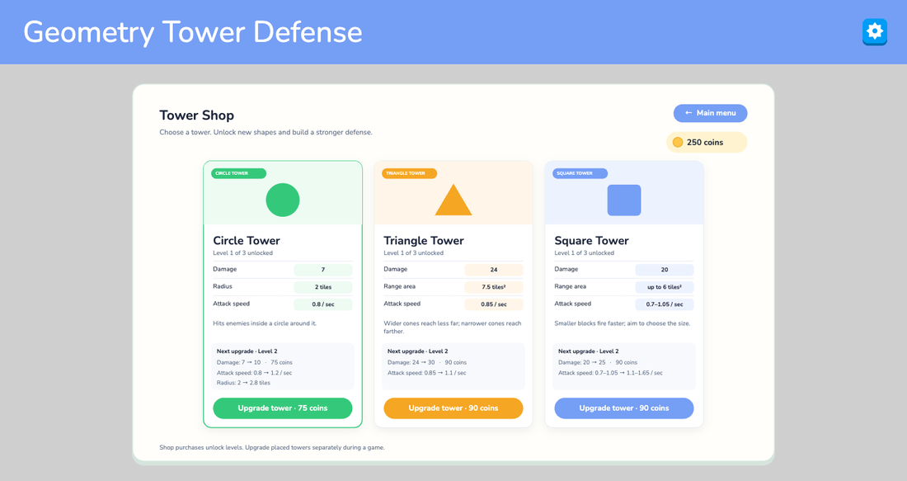

# Geometry Tower Defense

A tower defense game where you answer geometry questions to build your defenses. Every tower is a shape, and every question is about the shape you are placing: its radius, its area, its angle. Built by CSE 110 Group 2 with TypeScript, Vite, and Konva.

**Play it online:** https://sophiagao0787.github.io/cse110-Project-Group2/



## Features

- **Four maps** (Circle Grove, Angle Canyon, Area Archipelago, Prism Peaks), each with its own path and waves. Winning a map unlocks the next one.
- **Three towers, three shapes.** The circle tower hits everything in its circle. The triangle and square towers are aimed by the player.
- **A geometry question for every tower.** Most questions use the numbers of the tower being placed, so aiming a tower changes its question.
- **Three kinds of enemies** (basic, fast, and tank), with health bars, coin rewards, and a life lost for each one that gets through.
- **Stars and stats** at the end of every game, and the best stars on each map are kept on the map screen.
- **Tower Shop** to unlock towers and raise their upgrade level, and **two mini-games** that earn bonus coins.
- **Double speed, music, and sound effects**, with a settings menu to pause the game or switch the sound off.

## Play it

```sh
npm install
npm run dev
```

Then open the URL Vite prints (usually http://localhost:5173).

## How to play

1. Click **Play** on the main menu and pick a map. Winning a map unlocks the next one. The first game on Circle Grove offers a short tour, which can be skipped.
2. Drag a tower from the shop on the right onto a green tile. For a triangle or square tower, move the mouse to aim its cone or block. Then press **Enter**.
3. Answer the geometry question. It is about the tower you are placing or about general geometry, and you get two attempts. Questions get harder on later maps. A correct answer places the tower and spends its coins. A wrong answer, or skipping the question, costs a quarter of the tower's price.
4. Click **Start Wave** to send enemies down the path. A white arrow shows where they come in, and a red flag shows where they leave. Defeating an enemy earns coins, clearing a wave earns bonus coins, and each enemy that reaches the end costs a life. After a wave, the next one starts when its countdown ends.
5. Hover over or click a placed tower to open its information panel. Use **Upgrade Tower** to upgrade it, up to the level bought in the Tower Shop, or **Sell Tower** to recover half of its purchase and upgrade costs, rounded down.
6. Clear the last wave with lives left to win. Losing every life ends the game in defeat. Either way, the result screen shows your stars, score, and stats.

During a game, the speed button (or **Space**) switches between normal and double speed. The gear button opens the settings, where the music and the sound effects can each be switched off.

| Choose a map                                         | See how you did                          |
| ---------------------------------------------------- | ---------------------------------------- |
|  |  |

## Towers

| Tower    | Cost | Range                                                                                                 |
| -------- | ---- | ----------------------------------------------------------------------------------------------------- |
| Circle   | 50   | A circle of radius 2 tiles. Hits every enemy inside it.                                               |
| Triangle | 70   | A cone with a fixed area. A wider cone reaches less far. Hits the front-most enemy.                   |
| Square   | 75   | A block of up to 6 tiles next to the tower. Hits every enemy inside it. A smaller block fires faster. |

The triangle and square towers are aimed after they are dropped: move the mouse to turn them, and move it closer or further to change the cone's angle or the block's size. Then press **Enter** for the question.

**Triangle tower:** the question asks about the cone you aimed, here what fraction of a full circle a 46° cone is.



**Square tower:** the block snaps to whole tiles, and the question asks about the block you chose.



Answers can be numbers, fractions, or expressions such as `2.5*2`, `46/360`, or `6.25π`. The **π** and **√** buttons under the answer box type those symbols, and a line under the box reminds you which formats work.

## Tower Shop and mini-games

The **Tower Shop** unlocks the triangle and square towers and raises each tower's upgrade level. A placed tower can be upgraded in a game up to the level bought here. The shop has its own coin balance. Every win earns 25 shop coins per star (25, 50, or 75), shown on the result screen, so replaying a map earns more. Losing or leaving early earns none; gameplay coins and mini-game bonuses stay separate.



**Geometry Quiz** is a five-question round with 25 seconds per question. Each correct answer adds 5 bonus coins to your next game, up to 50. After each answer, the next question shows by itself.


From the main menu, select **Mini-game → Room Builder**, then choose **Easy**, **Medium**, or **Hard**. Each difficulty randomly picks from three predetermined full-cell layouts, each with four inventories verified to fill the room exactly. Drag benches, square towers, and triangle towers from the menu onto the room's grid. A green preview means the piece fits. Drag placed pieces to reposition them. Select a bench or triangle and use **Rotate** to turn it. Use **Undo** to reverse the last placement, move, or rotation, or **Reset Room** to start over.

Each square meter of shape area earns 10 points. Each triangle scores 2 m². Complementary triangles can share a 2 × 2 space. **Finish Room** awards a share of the difficulty maximum based on the fraction of usable area filled, rounded down. A perfect room earns 20, 30, or 40 coins by difficulty, subject to the shared 50-coin savings cap. Both mini-games share the balance, which goes into your next tower defense game. **Reset Room** and **Try Again** retain the current layout and inventory. **Next Puzzle** picks a different combination at the same difficulty.

The browser saves map stars, the tutorial flag, shop coins, tower upgrades, unused mini-game bonus coins, and the music and sound switches across reloads. **Reset progress** on the main menu starts over from map 1 with a new Tower Shop; it asks first and keeps the music and sound switches.

**Coming next (Sprint 3):** New music and sound effects, and more settings. The full list is in the [Sprint 3 backlog](https://github.com/SOPHIAGAO0787/cse110-Project-Group2/issues/103).

## How the code is organized

```
src/
  main.ts             starts the App
  app/                App (owns the Konva stage, switches screens) and screen types
  core/               EventBus (game events), GameLoop (calls tick every frame), and Sound
  model/              game rules and state: plain TypeScript, no Konva, unit tested
    GameModel.ts      holds everything for one game and runs each tick in order
    types.ts          shared shapes and the list of game events
    TileArt.ts        which picture goes on which tile of a textured map
    Progress.ts       what is kept between games: the chosen map, stars, and bonus coins
    geometry/         tower range shapes
    questions/        picks and checks geometry questions
    minigame/         the quiz and Room Builder rules
    shop/             shop data: tower costs, stats, and upgrades
  data/               maps, towers, enemies, upgrades, and questions (JSON)
  screens/            Menu, Map Select and Result screens, and what screens share:
                      Page (header and card), theme (colors and font), and buttons
    game/             the game screen: view, controller, grid, towers, enemies, effects,
                      placement, question popup, and settings
    minigame/         the minigame picker, quiz, and Room Builder
    shop/             the Tower Shop screen
assets/               images for this README
public/audio/         the music loop and the sound effects (see Sound credits)
public/tilesets/      the picture sheets that textured maps are drawn from
```

Three rules keep it working:

- **A number or a decision goes in `model/`. A pixel goes in `screens/`.** Model code never imports Konva, so it can be tested without a browser.
- **Positions in the model are in tiles**, not pixels. `(3, 2)` is the center of the tile in column 3, row 2. Views multiply by `TILE`.
- **Parts talk through events.** For example, an enemy dying emits `enemyKilled`, and the wallet listens for it. In tests, emit the event yourself instead of waiting for another part to be finished.

## Drawing a map with pictures

A map is drawn in plain colors unless it names a **tileset**. A tileset is one picture sheet, cut into square cells, plus a legend that gives each cell a one-character name (`src/data/tilesets/<id>.json`, with the sheet in `public/tilesets/`).

```json
"tileset": "meadow",
"art": [
  "................",
  "----7...........",
  "##..|.###......."
]
```

- `art` is one character per tile, the same size as `tiles`. Each character is a name from the legend. Leave `art` out and it is worked out from `tiles` and `path`.
- **A picture has to match its tile.** `#` tiles take a `buildable` picture, `.` a `blocked` one, and `P` a `path` one. A road piece also lists the sides it opens onto (`connects`), and it has to match the route there. `npm test` fails with the tile's position if it does not.
- A legend entry with several `cells` picks one for each tile, always the same one, so grass does not repeat. Give it a single cell to choose by hand.
- `rotation` turns a cell, so one drawing can stand in for a corner you have not drawn yet. `inset` shaves pixels off every cell edge if the export left a thin line there.
- Maps without a `tileset` keep working, and so does a map whose sheet fails to load.

## Sound credits

The music and the effects for waves, pops, lost lives, placing towers, winning, losing, wrong answers, upgrades, and not enough coins were made for this game. The three tower shots are from [Freesound](https://freesound.org), converted to MP3 for the game:

| Tower shot               | File                             | Original sound                                            | Author                                                     | License                                                   |
| ------------------------ | -------------------------------- | --------------------------------------------------------- | ---------------------------------------------------------- | --------------------------------------------------------- |
| Circle tower             | `public/audio/fire-circle.mp3`   | [toy_drum_light_hit.wav](https://freesound.org/s/332389/) | [felisleopard](https://freesound.org/people/felisleopard/) | [CC0](https://creativecommons.org/publicdomain/zero/1.0/) |
| Triangle tower           | `public/audio/fire-triangle.mp3` | [ELECLASER.wav](https://freesound.org/s/441640/)          | [xtrgamr](https://freesound.org/people/xtrgamr/)           | [CC BY 4.0](https://creativecommons.org/licenses/by/4.0/) |
| Square (rectangle) tower | `public/audio/fire-square.mp3`   | [kick12](https://freesound.org/s/332363/)                 | [soneproject](https://freesound.org/people/soneproject/)   | [CC0](https://creativecommons.org/publicdomain/zero/1.0/) |

## Scripts

| Command                | What it does                            |
| ---------------------- | --------------------------------------- |
| `npm run dev`          | start the dev server                    |
| `npm test`             | run the unit tests (Vitest)             |
| `npm run test:watch`   | re-run the tests as you edit            |
| `npm run build`        | type-check and build to `dist/`         |
| `npm run format`       | format all files with Prettier          |
| `npm run format:check` | check formatting without changing files |
| `npm run preview`      | serve the production build              |

CI builds the game (which includes the type check), checks formatting, and runs the tests on every pull request and on every push to `main`.

## Contributing

1. Pick an issue on the project board, or create a sub-issue under its user story.
2. `git switch main && git pull`, then `git switch -c feat/<short-name>`.
3. Write tests for the new behavior and make them pass (`npm test`).
4. Open a pull request, fill in the template with `Closes #<issue>`, add the user story's label, and ask a teammate to review.
5. Merge with a merge commit after one approval and green CI.
