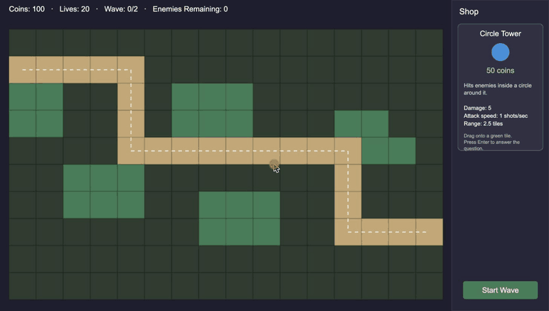

# Geometry Tower Defense

A tower defense game where you answer geometry questions to build your defenses. Built by CSE 110 Group 2 with TypeScript, Vite, and Konva.



## Play it

```sh
npm install
npm run dev
```

Then open the URL Vite prints (usually http://localhost:5173).

## How to play

1. Click **Play Map 1** on the menu.
2. Drag the tower from the shop on the right onto a green tile, then press **Enter**.
3. Answer the geometry question about the tower's range. A correct answer places the tower and spends its coins.
4. Click **Start Wave** to send enemies down the path. Each enemy that reaches the end costs a life.
5. Clear the last wave with lives left to win. Losing every life ends the game in defeat. Either way, the result screen shows your stars and stats.

The menu also has a **Tower Shop** screen that shows each tower's cost, stats, and upgrades. It is a demo with its own coins and is not connected to the game yet.

**Works today:** the map, tower placement with a question, coins, lives, waves, and the victory and defeat screens.
**Coming next:** towers attacking enemies, choosing towers from the in-game shop, and connecting the Tower Shop to the game.

## How the code is organized

```
src/
  main.ts             starts the App
  app/                App (owns the Konva stage, switches screens) and screen types
  core/               EventBus (game events) and GameLoop (calls tick every frame)
  model/              game rules and state: plain TypeScript, no Konva, unit tested
    GameModel.ts      holds everything for one game and runs each tick in order
    types.ts          shared shapes and the list of game events
    geometry/         tower range shapes
    questions/        picks and checks geometry questions
    shop/             shop data: tower costs, stats, and upgrades
  data/               maps, towers, enemies, upgrades, and questions (JSON)
  screens/            Menu and Result screens, and the shared button
    game/             the game screen: view, controller, grid, enemies, placement, question popup
    shop/             the Tower Shop screen
assets/               images for this README
```

Three rules keep it working:

- **A number or a decision goes in `model/`. A pixel goes in `screens/`.** Model code never imports Konva, so it can be tested without a browser.
- **Positions in the model are in tiles**, not pixels. `(3, 2)` is the center of the tile in column 3, row 2. Views multiply by `TILE`.
- **Parts talk through events.** For example, an enemy dying emits `enemyKilled`, and the wallet listens for it. In tests, emit the event yourself instead of waiting for another part to be finished.

## Scripts

| Command                | What it does                            |
| ---------------------- | --------------------------------------- |
| `npm run dev`          | start the dev server                    |
| `npm test`             | run the unit tests (Vitest)             |
| `npm run test:watch`   | re-run the tests as you edit            |
| `npm run build`        | type-check and build to `dist/`         |
| `npm run format`       | format all files with Prettier          |
| `npm run format:check` | check formatting without changing files |
| `npm run preview`      | serve the production build              |

CI builds the game (which includes the type check), checks formatting, and runs the tests on every pull request and on every push to `main`.

## Contributing

1. Pick an issue on the project board, or create a sub-issue under its user story.
2. `git switch main && git pull`, then `git switch -c feat/<short-name>`.
3. Write tests for the new behavior and make them pass (`npm test`).
4. Open a pull request, fill in the template with `Closes #<issue>`, add the user story's label, and ask a teammate to review.
5. Merge with a merge commit after one approval and green CI.
